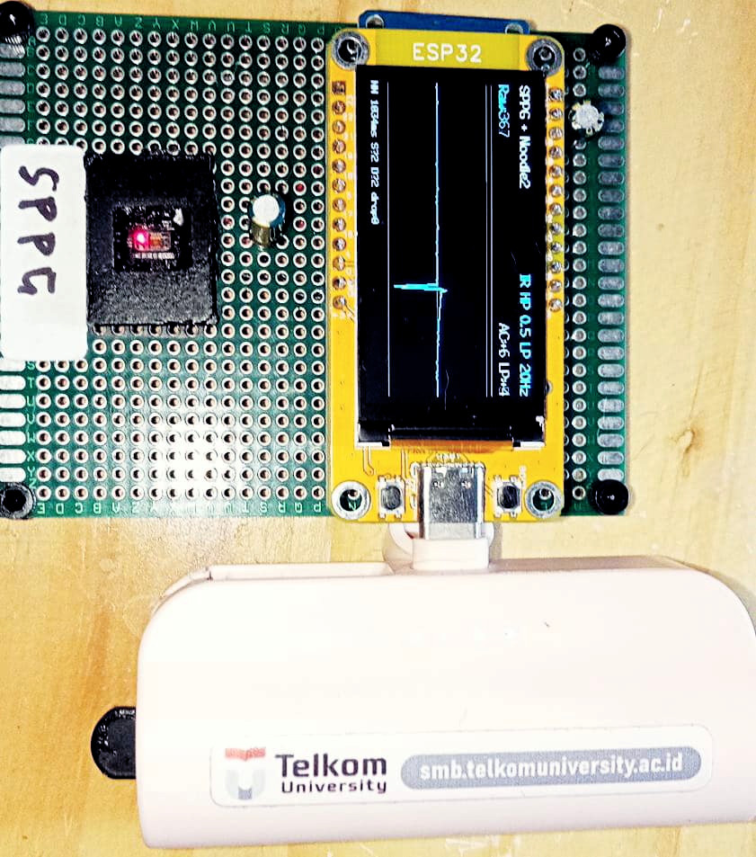

# SPPG — Smart Photoplethysmography

SPPG is a small ESP32-based photoplethysmography instrument built around the **MAX30102**, a **1.9-inch ST7789 LCD ESP32 board**, and **Noodle2** for on-device INT8 neural-network inference.

It can:

- acquire **RED** and **IR** PPG signals from the MAX30102,
- show the waveform live on the built-in LCD,
- apply **2nd-order Tustin Butterworth HPF/LPF** for display,
- run a compact **PeakNet** model with **Noodle2**,
- show tentative **`S?`** and **`D?`** peak markers,
- and save **10 seconds of raw RED+IR data** to a microSD card when the **BOOT** button is pressed.

> `S?` and `D?` are intentionally shown with question marks because they are **model predictions**, not yet clinically validated physiological labels.

## Project photo



https://github.com/user-attachments/assets/85aef304-58bd-492b-8786-6c8ac44fdd6b

## Hardware

### Main board
- Classic **ESP32** HMI board
- **4 MB Flash**, no PSRAM
- **CH340** USB-to-serial
- **1.9-inch 170×320 ST7789 LCD**

### Sensor
- **MAX30102** optical pulse sensor

### Optional storage
- **microSD card module** over SPI

## Wiring

### MAX30102 → ESP32

| MAX30102 | ESP32 GPIO |
|---|---:|
| SDA | 4 |
| SCL | 5 |
| VCC | 3V3 |
| GND | GND |

### LCD (already on the board)

| LCD signal | ESP32 GPIO |
|---|---:|
| MOSI | 13 |
| SCLK | 14 |
| CS | 15 |
| DC | 2 |
| Backlight | 21 |

### microSD → ESP32 (HSPI)

| microSD | ESP32 GPIO |
|---|---:|
| SCK | 18 |
| MISO | 19 |
| MOSI | 23 |
| CS | 27 |
| VCC | 3V3 |
| GND | GND |

## Main firmware features

### Acquisition and display
- MAX30102 configured at **100 Hz**
- **411 µs pulse width**
- **18-bit ADC resolution**
- **RED + IR** enabled
- live waveform display on the LCD

### Display filters
The displayed waveform uses:
- **HPF:** 2nd-order Tustin Butterworth, **0.5 Hz**
- **LPF:** 2nd-order Tustin Butterworth, **20 Hz**

These filters are used for the **display path**. The SD recorder stores the **raw** RED and IR samples.

### SD recording
Press the **BOOT** button to record approximately **10 seconds** of raw PPG data to microSD.

The files are automatically named:

- `PPG0001.CSV`
- `PPG0002.CSV`
- `PPG0003.CSV`
- ...

Each file stores raw **RED** and **IR** samples for offline analysis.

### Noodle2 inference
SPPG integrates a compact **PeakNet** model running with **Noodle2**:

- **INT8** weights and activations
- **Flash-backed parameters**
- **activation-memory reuse**
- **tiled convolution** (`tile=4`)
- live candidate markers displayed as **`S?`** and **`D?`**

This project is a good small demonstration of the Noodle2 philosophy:

- CHW tensor layout,
- automatic activation memory reuse,
- fused activation,
- tiled convolution,
- and a clean graph-based API.

## Project structure

```text
.
├── assets/                  # README image
├── include/                 # filters, PeakNet model, manifests, generated headers
├── lib/Noodle2/             # Noodle2 runtime
├── src/main.cpp             # main firmware
├── platformio.ini           # final PlatformIO environments
└── .gitignore
```

## PlatformIO environments

The cleaned project keeps only the most useful environments:

| Environment | Description |
|---|---|
| `ir` | IR channel with HPF + LPF (**default**) |
| `red` | RED channel with HPF + LPF |
| `ir-hpf` | IR channel with HPF only |
| `red-hpf` | RED channel with HPF only |
| `ir-raw` | raw IR display |
| `red-raw` | raw RED display |

## Build and upload

Open the folder in **VS Code + PlatformIO**.

### Default build (recommended)

```bash
pio run -e ir -t upload
pio device monitor -b 115200
```

### Other variants

```bash
pio run -e red -t upload
pio run -e ir-raw -t upload
pio run -e red-raw -t upload
```

## Expected serial startup information

You should see lines similar to:

```text
# chip=ESP32-D0WD-V3 revision=3 flash=4194304 bytes, PSRAM=0 bytes
# SD card: READY (HSPI SCK18 MISO19 MOSI23 CS27)
# filters TUSTIN_BUTTERWORTH2 fs=100Hz HPF=0.500Hz LPF=20.000Hz
# sensor settings verified: 100Hz, 411us, 18bit, 8192nA, AVG1, RED+IR
# NN started core0 arena=10496 params=10304 nodes=7 hop=128 input=-rawIR/zscore tile=4
```

## Notes

- The neural-network labels are still **experimental**.
- The waveform display and the NN inference are intended for **research and prototyping**, not clinical use.
- The project was cleaned for GitHub from the latest working version, with diagnostic and development-history configurations removed.

## Acknowledgment

This project uses:
- **TFT_eSPI** by Bodmer
- **SparkFun MAX3010x** sensor library
- **Noodle2** runtime integrated in `lib/Noodle2/`
